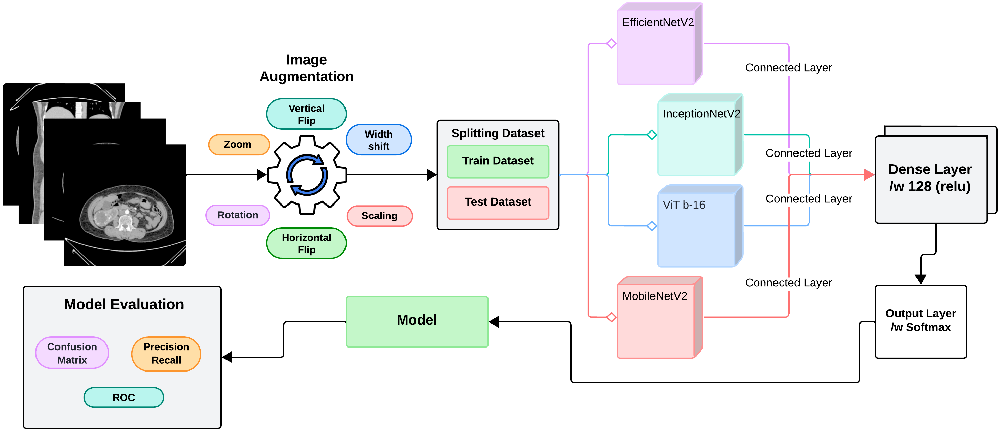
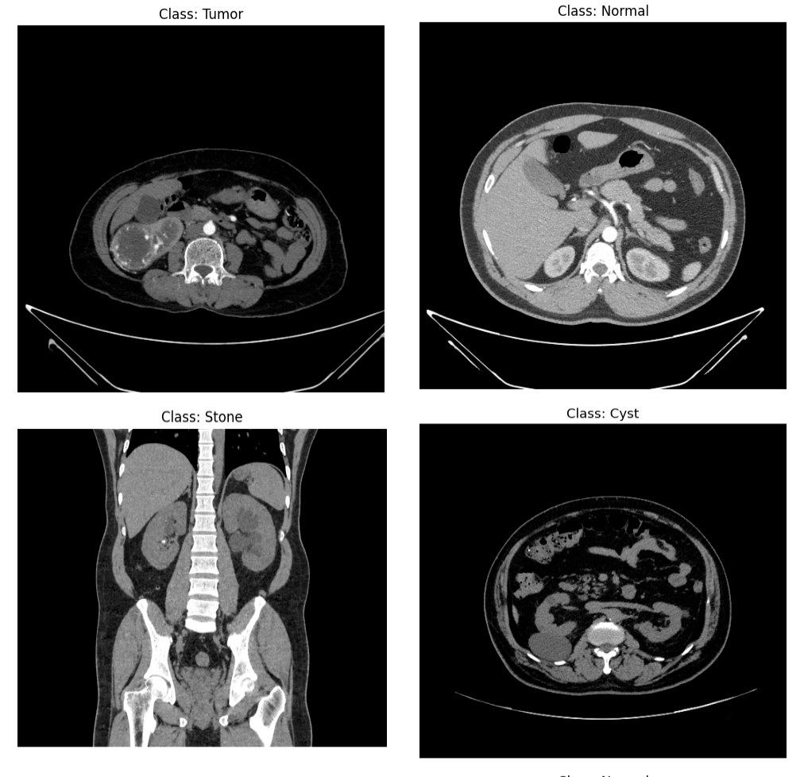
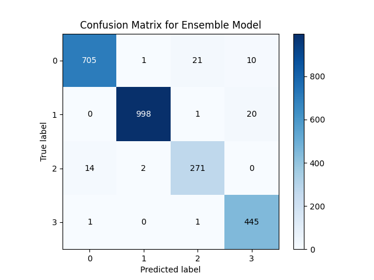
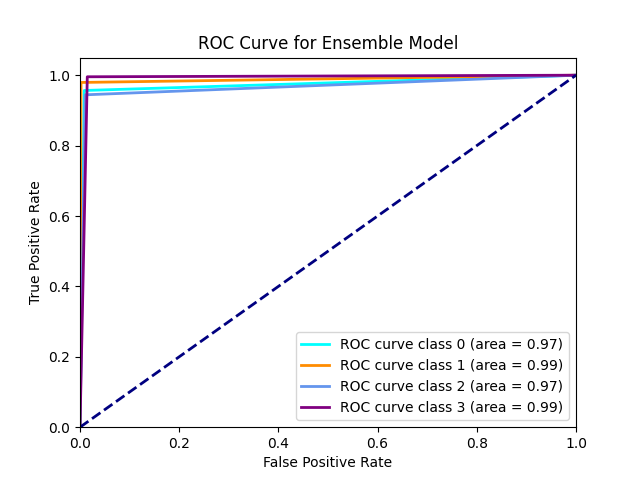
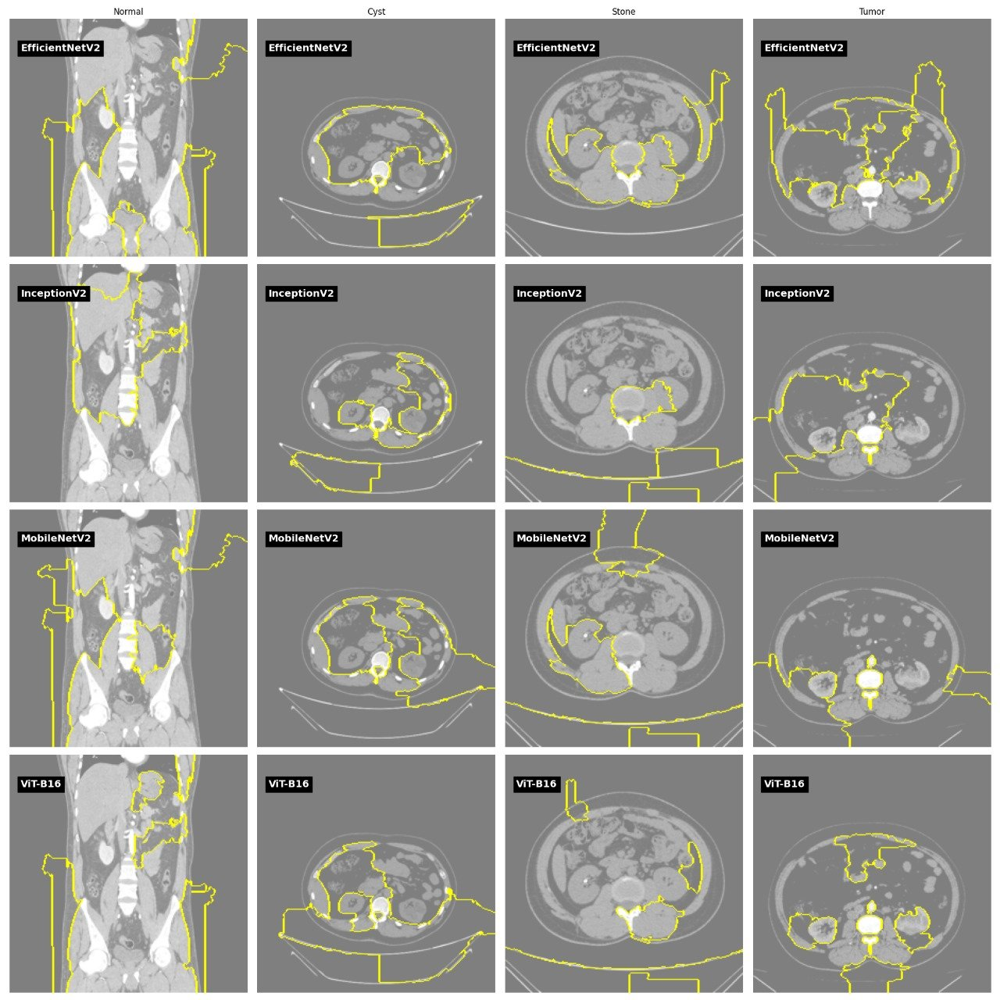

# Kidney Disease Classification from CT with a CNN–ViT Ensemble and Explainable AI (LIME)

Code for the paper:

> **Md. Arifuzzaman**, Iftekhar Ahmed, Md. Jalal Uddin Chowdhury, Shadman Sakib, Mohammad Shoaib Rahman, Md. Ebrahim Hossain, Shakib Absar.
> **A Novel Ensemble-Based Deep Learning Model with Explainable AI for Accurate Kidney Disease Diagnosis.**
> *Advances in Artificial Intelligence and Machine Learning (AIAIML)*, 5(1), 2025.
> [Paper (PDF)](https://www.oajaiml.com/uploads/archivepdf/416551196.pdf)

[](https://colab.research.google.com/github/arifex/CKD/blob/main/ct-kidney-dl.ipynb)

## Overview

The model classifies a single kidney CT slice into one of four classes: **Normal, Cyst, Stone or Tumor**.

Four ImageNet-pretrained backbones process each slice in parallel:

- **EfficientNetV2**: compound scaling of depth, width and resolution
- **InceptionNet-V2**: parallel multi-scale convolutions
- **MobileNetV2**: depthwise-separable convolutions
- **ViT-B/16**: Vision Transformer with global self-attention over 16 × 16 patches

Their feature vectors are **concatenated** (feature-level fusion, not majority voting) and passed to a dense layer and a softmax classifier. **LIME** then shows which image regions drive each model's prediction.



## Dataset

**CT KIDNEY DATASET: Normal–Cyst–Tumor and Stone** — Islam et al., *Scientific Reports* 12, 11440 (2022). [Kaggle](https://www.kaggle.com/datasets/nazmul0087/ct-kidney-dataset-normal-cyst-tumor-and-stone)

The scans were collected from hospitals in Dhaka, Bangladesh. The dataset contains **12,446 CT slices** from axial and coronal cuts, in both contrast and non-contrast studies:

| Class | Images |
|---|---|
| Normal | 5,077 |
| Cyst | 3,709 |
| Tumor | 2,283 |
| Stone | 1,377 |

The dataset is not included in this repository because of its size. The notebook downloads it from Kaggle (see *How to run*).



## Method

| Step | Details |
|---|---|
| Preprocessing | resize to 224 × 224, `LabelEncoder` → one-hot labels |
| Augmentation (train only) | rotation, zoom, horizontal/vertical flip, shifts (`ImageDataGenerator`) |
| Split | 80 % train / 20 % test (2,490 test slices) |
| Backbones | EfficientNetV2, InceptionNet-V2, MobileNetV2, ViT-B/16 (ImageNet weights, fine-tuned) |
| Fusion head | concatenate features → Dense(128, ReLU) → Dense(4, softmax) |
| Training | Adam, categorical cross-entropy, batch size 32, up to 50 epochs, early stopping (patience 5) |
| Explainability | LIME superpixel explanations for each backbone and class |
| Evaluation | accuracy, precision, recall, F1, ROC-AUC, precision–recall curves, confusion matrix |

## Results

### Individual backbones vs ensemble (macro average over 4 classes, %)

| Model | Precision | Recall | F1 | AUC |
|---|---|---|---|---|
| InceptionNet-V2 | 83.3 | 79.8 | 80.8 | 87.3 |
| EfficientNetV2 | 86.8 | 85.5 | 85.9 | 90.8 |
| MobileNetV2 | 87.3 | 87.5 | 87.3 | 92.0 |
| ViT-B/16 | 91.5 | 89.3 | 90.0 | 93.3 |
| **Ensemble (ours)** | **95.9** | **96.9** | **96.4** | **98.0** |

**Ensemble test accuracy: 97.1%**, with 2,419 of 2,490 slices classified correctly.

### Ensemble per-class performance

| Class | Precision | Recall | F1 | Test slices |
|---|---|---|---|---|
| Cyst | 97.9 | 95.7 | 96.8 | 737 |
| Normal | 99.7 | 97.9 | 98.8 | 1,019 |
| Stone | 92.2 | 94.4 | 93.3 | 287 |
| Tumor | 93.7 | 99.6 | 96.5 | 447 |

The ensemble metrics are computed from the confusion matrix in the paper. The most frequent errors are confusions between cyst and stone, which can look alike on a single 2D slice.

| Confusion matrix | ROC curves |
|---|---|
|  |  |

### LIME explanations

Rows show EfficientNetV2, InceptionV2, MobileNetV2 and ViT-B/16; columns show Normal, Cyst, Stone and Tumor. Yellow outlines mark the superpixels that most influenced each prediction. EfficientNetV2 localised cysts and tumors best, while MobileNetV2 was strongest on normal and stone slices. This complementary behaviour motivated the ensemble.



## Limitations and future work

- **Slice-level random split:** neighbouring slices of the same patient can appear in both train and test sets, which may make test scores optimistic. A patient-level split is planned.
- **Single source:** all data comes from one public dataset. External validation on another hospital's data is needed.
- **2D only:** single slices lack 3D context. 2.5D/3D models may separate cysts from stones better.
- **Explanation sanity:** some LIME regions fall outside the kidney, for example on the spine or scanner table. Kidney segmentation before classification, and quantitative checks of the explanations, are next steps.

## How to run

**Google Colab (recommended)**
1. Click the **Open in Colab** badge above and choose **Runtime → Change runtime type → T4 GPU**.
2. Get a Kaggle API token: Kaggle → Settings → **Create New Token**, which downloads `kaggle.json`.
3. Run the first cells and upload `kaggle.json` when prompted. The dataset downloads automatically.
4. Click **Runtime → Run all**.

**Locally**
```bash
git clone https://github.com/arifex/CKD.git
cd CKD
pip install -r requirements.txt
kaggle datasets download -d nazmul0087/ct-kidney-dataset-normal-cyst-tumor-and-stone -p data --unzip
jupyter notebook ct-kidney-dl.ipynb
```

## Repository structure

```
├── ct-kidney-dl.ipynb             # training, evaluation and LIME
├── copy_of_ct_kidney_dl.py        # script version of the notebook
├── pipeline.png                   # figures from the paper
├── sample_ct_slices.jpg
├── ensemble_confusion_matrix.png
├── ensemble_roc.png
├── lime_explanations.jpg
├── requirements.txt
└── README.md
```

## Citation

```bibtex
@article{arifuzzaman2025kidney,
  author  = {Arifuzzaman, Md. and Ahmed, Iftekhar and Chowdhury, Md. Jalal Uddin and
             Sakib, Shadman and Rahman, Mohammad Shoaib and Hossain, Md. Ebrahim and Absar, Shakib},
  title   = {A Novel Ensemble-Based Deep Learning Model with Explainable AI for
             Accurate Kidney Disease Diagnosis},
  journal = {Advances in Artificial Intelligence and Machine Learning},
  volume  = {5},
  number  = {1},
  year    = {2025}
}
```

Please also cite the dataset:

```bibtex
@article{islam2022vision,
  author  = {Islam, Md Nazmul and Hasan, Mehedi and Hossain, Md Kabir and Alam, Md Golam Rabiul and
             Uddin, Md Zia and Soylu, Ahmet},
  title   = {Vision transformer and explainable transfer learning models for auto detection of
             kidney cyst, stone and tumor from {CT}-radiography},
  journal = {Scientific Reports},
  volume  = {12},
  pages   = {11440},
  year    = {2022}
}
```

## Author

**Md. Arifuzzaman** — Assistant Professor, Department of CSE, Leading University, Sylhet, Bangladesh
[Google Scholar](https://scholar.google.com/citations?hl=en&user=ngntKZ8AAAAJ) · [GitHub](https://github.com/arifex)
